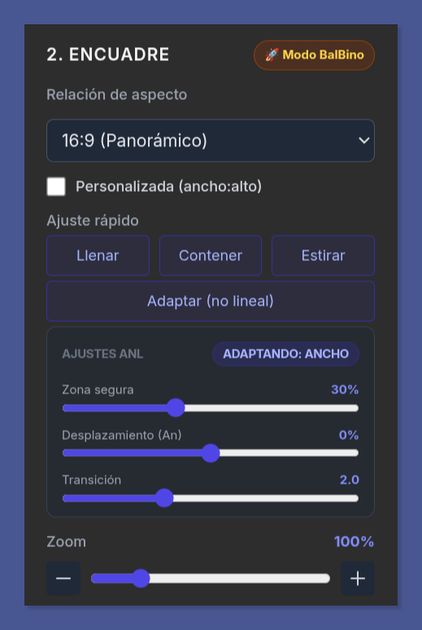
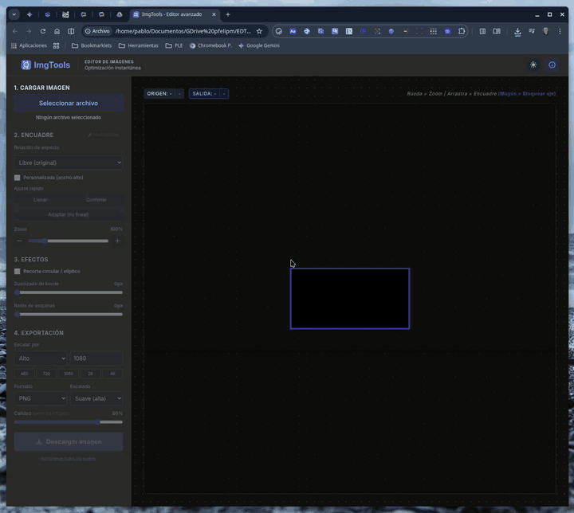

# ImgTools 📸 🚀

> La herramienta definitiva para conseguir que **BalBino** deje de dar la paliza 😘 con las cabeceras del blog de **GEG Spain**.

### 🌐 Acceso temporal a la versión 2.0 (Beta): [pfelipm.github.io/imgtools](https://pfelipm.github.io/imgtools/)

> [!IMPORTANT]
> 🧪 **Guía provisional de `v2.0` para probadores:** Para evaluar esta nueva generación en desarrollo utiliza temporalmente **[https://pfelipm.github.io/imgtools/](https://pfelipm.github.io/imgtools/)**. El dominio de producción ([imgtools.pablofelip.online](https://imgtools.pablofelip.online)) mantiene por ahora la versión estable `1.0` hasta finalizar las pruebas.
>
> 🖼️ **Nota sobre las imágenes de este documento:** Las capturas de pantalla estáticas mostradas más abajo corresponden provisionalmente a la versión `1.0` y se renovarán con vistas de la interfaz `2.0` antes de la publicación definitiva en producción.

  
   
  <em>Captura provisional correspondiente a la interfaz de la versión 1.0.</em>

## 🎯 ¿Qué es ImgTools y por qué existe?

**ImgTools** es un editor y optimizador de imágenes pensado para ir al grano desde el navegador: **100% local, privado y sin servidor** (ninguna imagen se sube a internet; todo ocurre en tu propio equipo). Permite cambiar de formato y resolución, girar o encuadrar fotografías, adaptar proporciones panorámicas sin deformar rostros ni logotipos, aplicar fondos o recortes redondeados y procesar tanto una foto suelta como lotes enteros descargables en `.zip` en cuestión de segundos.

Si además formas parte del equipo de coordinación de **GEG Spain**, conoces el ritual. BalBino, con todo el amor del mundo y su infinita paciencia manteniendo nuestra web en [transformacioneducativa.es](https://transformacioneducativa.es), nos ha impuesto un flujo de trabajo digno de las doce pruebas de Hércules:

1. Abrir una presentación de Google configurada a 1920×1080.
2. Subir tu imagen, ajustarla a la diapositiva y rezar para que el encuadre sea 16:9.
3. Descargar la diapositiva como imagen.
4. Pasarla por herramientas externas para que el archivo no pese más que nuestra conciencia.
5. Subir a WordPress.

**¡Basta!** ImgTools nació como una "protesta-broma" cariñosa para automatizar este proceso. Queremos mucho a BalBino, pero queremos más nuestro tiempo: lo que antes llevaba 5 minutos ahora se resuelve en un clic.

## 🆕 Novedades destacadas en ImgTools 2.0

Si vienes de la versión `1.0` (o si la pruebas por primera vez), esto es lo principal que incorpora la nueva rama `v2.0`:

*   **Procesamiento por lotes (*Batch*) y exportación `.zip`:** trabaja igual que siempre con **1 imagen** o carga **2 o más** para editarlas con una receta común y descargar todas a la vez en un `.zip` local (modo *STORE* sin recomprimir).
*   **Ámbito explícito (`Lote` vs `● Actual`):** insignias claras en la barra lateral y botones conmutables (`● Actual ⇄` ↔ `Todo el lote ⇄`) en **Orientación de origen** y **Ajuste rápido** para decidir en cada momento qué cambia solo en la foto visible y qué afecta a todo el lote.
*   **Más formatos de entrada y salida:** importa **`SVG` vectorial** (rasterizado nítido a alta densidad), **`AVIF`**, **`GIF`** y **`BMP`** (además de `JPG`, `PNG` y `WEBP`), y exporta también a **`AVIF`** cuando tu navegador soporta codificación nativa.
*   **Carga por *Drag & Drop* y portapapeles:** arrastra archivos desde cualquier sitio de la ventana, pega capturas o SVG con **`Ctrl+V`** y usa el botón **Copiar al portapapeles** (`Ctrl+Mayús+C`).
*   **Orientación previa de origen:** gira en pasos de **`90°`** (con animación suave) y voltea en espejo horizontal (`H`) o vertical (`V`) antes de encuadrar o aplicar Adaptación No Lineal.
*   **Fondos para *Contener* y transparencias:** elige entre **Transparente** (con cuadrícula damero en formatos con canal alfa o fondo blanco automático al exportar a `JPG`), **Desenfocado (*Blur-fill*)** con brillo ajustable (`-50%` a `+50%`) o **Color** sólido (blanco, negro o selector libre).
*   **Perfiles rápidos y preajustes propios:** selector listo para usar (*LinkedIn*, *Instagram*, *YouTube*, *Google Classroom*, *Google Forms*) y guardado de **preajustes personalizados** en tu navegador, manteniendo intacto **🚀 Modo BalBino**.
*   **Comparación instantánea Antes / Después:** mantén pulsado **Ver original** o la tecla **`Espacio`** para comprobar el resultado frente al original al vuelo.
*   **Panel lateral ergonómico y PWA 100% *Offline*:** secciones colapsables con pie de acciones siempre visible, cálculo real del peso de salida en tiempo real, edición numérica directa en cualquier etiqueta de valor, atajos de teclado, recepción desde el menú *Compartir* (*Web Share Target*) y avisos automáticos cuando hay una nueva versión.

## 🚀 El mítico "Modo BalBino" y los Perfiles rápidos

### 🚀 Modo BalBino (Cabecera GEG Spain)

La joya de la corona. Un botón dorado que, al pulsarlo, restablece deformaciones o recortes previos y configura en un instante:
*   Relación de aspecto **16:9** exacta (`1920×1080 px` sin recortes ni truncamientos).
*   Formato **WebP** optimizado al **80%** de calidad.
*   Escalado suave de **alta calidad**.

**Resultado:** una cabecera lista para WordPress, ligera, nítida y, lo más importante, **BalBino-approved**.

### 📐 Perfiles rápidos integrados y preajustes propios

Justo debajo dispones de un selector de **Perfiles rápidos** con medidas habituales (todos exportables con un clic o combinables con el lote):
*   **Redes sociales:** *LinkedIn Post* (`1200×627`), *LinkedIn Banner* (`1584×396`), *Instagram Cuadrado* (`1080×1080`), *Instagram Vertical* (`1080×1350`) y *Miniatura YouTube* (`1280×720`).
*   **Plataformas educativas:** *Cabecera Google Classroom* (`1000×250`) y *Cabecera Google Forms* (`1600×400`).
*   **Mis preajustes:** pulsa **`+ Guardar actual`** para memorizar tu propia combinación de relación de aspecto, escala, formato y calidad en `localStorage` (pudiendo borrarlos en cualquier momento con el botón de papelera).

## ✨ Guía completa de funcionalidades

### 1. Carga de imágenes y trabajo por lotes (*Batch*)

*   **Formatos admitidos:** `JPG`, `PNG`, `WEBP`, `SVG` (vectorial, rasterizado nítido a alta resolución sin contaminar el lienzo), `AVIF`, `GIF` y `BMP`.
*   **Múltiples vías de entrada:** selector de archivos (`Ctrl/Cmd+O`), arrastrar y soltar en cualquier punto de la ventana, pegado directo desde el portapapeles (`Ctrl/Cmd+V`) o recepción desde *Compartir* en Android/escritorio cuando está instalada como PWA.
*   **Cero fricción con 1 foto, control total con 2 o más:**
    *   Con **1 imagen**, la barra inferior de lote permanece oculta para mantener el espacio despejado.
    *   Con **2 o más imágenes**, aparece la **tira de miniaturas** con el contador (`Lote: X / N`), el peso conjunto de origen, el aviso de fotos personalizadas (`● N ajustada(s)`), el botón **`+ Añadir`** (también disponible en la sección `1. Cargar imagen`), **`Descargar actual`** para bajar solo la foto en pantalla sin esperar al lote completo y **`Vaciar lote`**.
    *   Cada miniatura muestra un punto ámbar (`●`) si tiene orientación, ajuste rápido o encuadre particular, y un botón `×` para quitarla del lote.

#### Ámbito de los controles cuando hay un lote cargado

| Ajuste o sección | Comportamiento en modo Lote | Indicador en el panel |
| :--- | :--- | :--- |
| **🚀 Modo BalBino / Perfil rápido** | Global para todo el lote | Aplica la receta a todas las fotos |
| **Orientación de origen** (`90°`, `H`, `V`) | **Conmutable:** solo la imagen actual (por defecto) o todo el lote | Botón **`● Actual ⇄`** ↔ **`Todo el lote ⇄`** |
| **Relación de aspecto** | Siempre global | Etiqueta índigo **`Lote`** |
| **Ajuste rápido** (*Llenar*, *Contener*, *Estirar*, *ANL*) | **Conmutable:** todo el lote (por defecto) o solo la imagen actual | Botón **`Todo el lote ⇄`** ↔ **`● Actual ⇄`** |
| **Zoom, encuadre y Desplazamiento ANL** | Siempre individual de cada fotografía | Etiqueta ámbar **`● Actual`** |
| **Zona segura y Transición ANL** | Globales (comparten curva cuando ANL está activo) | Receta común ANL |
| **Fondo** (*Transparente*, *Desenfocado*, *Color*) | Siempre global | Etiqueta índigo **`Lote`** |
| **3. Efectos** (*Círculo*, *Suavizado*, *Radio*) | Siempre global | Pastilla naranja **`Activo`** + **`Lote`** |
| **4. Exportación** (*Tamaño*, *Formato*, *Escalado*, *Calidad*) | Siempre global | Resumen + etiqueta índigo **`Lote`** |

### 2. Encuadre, orientación, fondos y Adaptación No Lineal (ANL)

*   **Orientación de origen:** gira `90°` a izquierda o derecha (con animación suave en el lienzo) y voltea horizontal (`H`) o verticalmente (`V`) antes de recortar o adaptar proporciones.
*   **Relaciones de aspecto:** `Libre (original)`, `1:1 (Cuadrado / Avatar)`, `4:3 (Estándar)`, `16:9 (Panorámico)`, `16:10 (Monitor)`, `21:9 (Ultrawide)`, `21:10` y relación **Personalizada (`ancho:alto`)** con validación automática.
*   **Modos de ajuste rápido:**
    *   **Llenar:** escala la imagen para cubrir todo el lienzo sin bordes vacíos.
    *   **Contener:** encaja la imagen completa dentro del lienzo elegido.
    *   **Estirar:** realiza un estiramiento lineal uniforme hasta ocupar todo el espacio.
    *   **Adaptar (no lineal):** cambia la proporción del lienzo protegiendo al sujeto principal frente a deformaciones.
*   **Zoom y encuadre de precisión (`10%` a `500%`):** rueda del ratón centrada en el cursor, pellizco táctil con dos dedos (*pinch-to-zoom*), arrastre directo con bloqueo de eje (`Mayús`), ajuste fino con flechas (`1 px`, o `10 px` con `Mayús`) y doble clic en el lienzo para centrar.
*   **Relleno de fondo (para *Contener*, esquinas redondeadas o imágenes con transparencia):**
    *   **Transparente:** visible en pantalla mediante patrón damero al exportar en `PNG`, `WEBP` o `AVIF` (en `JPG`, formato sin transparencia, se aplana automáticamente sobre blanco para evitar fondos negros inesperados).
    *   **Desenfocado (*Blur-fill*):** rellena los huecos con una versión ampliada y suavizada de la propia foto y control de **Brillo del fondo** (`-50%` a `+50%`).
    *   **Color:** acceso rápido a **Blanco**, **Negro** o cualquier color hexadecimal mediante selector.

  
   
  <em>Captura provisional correspondiente al panel de encuadre en la versión 1.0 (en v2.0 incluye además perfiles rápidos, orientación de origen, relleno de fondo e indicadores de lote).</em>

#### 🧠 Los secretos de la Adaptación No Lineal (ANL)

Esta función permite transformar, por ejemplo, una fotografía vertical o cuadrada en una cabecera panorámica `16:9` evitando que las personas o logotipos del centro queden achatados o ensanchados.

  
   
  <em>Demostración del algoritmo de Adaptación No Lineal (ANL) grabada sobre la interfaz v1.0.</em>

**Funcionamiento interno:**
ImgTools detecta automáticamente si conviene adaptar ancho o alto y divide la imagen en **60 rebanadas** dibujadas con alineación exacta a píxeles enteros (sin costuras en imágenes semitransparentes):
*   **Zona segura (`0%` a `80%`):** define la franja central que conserva intacta su proporción original `1:1`.
*   **Desplazamiento (`-50%` a `+50%`):** descentra la zona segura hacia izquierda/derecha o arriba/abajo cuando el sujeto principal no está en el centro (es un ajuste propio de cada fotografía en los lotes).
*   **Transición (`1.0` a `4.0`):** controla la curvatura progresiva de la distorsión hacia los extremos.

Mientras mueves los deslizadores aparecen **guías verde neón** en una capa superpuesta temporal para visualizar los límites exactos de la zona segura sin manchar jamás la imagen exportada.

### 3. Efectos geométricos y de borde

La sección **`3. Efectos`** arranca plegada para aprovechar el espacio vertical; en cuanto aplicas alguno de sus controles aparece la pastilla naranja **`Activo`** junto a su cabecera:
*   **Recorte circular / elíptico:** perfecto para avatares, insignias o fichas.
*   **Suavizado de borde (*feather*):** desvanecimiento perimetral real hasta opacidad `0%` tanto en forma rectangular como circular.
*   **Radio de esquinas:** redondeo uniforme expresado en píxeles de salida.
*   **Límites proporcionales:** tanto el radio como el suavizado adaptan automáticamente su rango máximo según las dimensiones finales de exportación.

  
   
  <em>Captura provisional correspondiente a la sección de efectos en la versión 1.0.</em>

### 4. Exportación, métricas en tiempo real y acciones rápidas

*   **Resolución de salida:** escala por **Alto**, **Ancho**, **Lado largo** o mantén **Sin escala**; elige botones rápidos (`480`, `720`, `1080`, `2K` = `1440`, `4K` = `2160`) o escribe cualquier medida válida entre `1` y `16384 px`.
*   **Formatos y calidad:** exporta a **`PNG`**, **`WEBP`**, **`JPG`** y **`AVIF`** (si el navegador dispone de codificador nativo), ajustando la **Calidad** (`10%` a `100%`) en formatos con compresión y eligiendo el motor de escalado (**Suave (alta)** / **Suave (media)** con reducción progresiva *step-down* anti-moiré, o **Nítido (píxel)** para *pixel art*).
*   **Edición numérica directa:** haz clic en cualquier valor resaltado en azul/índigo (`Zoom`, `Brillo del fondo`, `Suavizado`, `Radio`, `Zona segura`, `Desplazamiento`, `Transición` o `Calidad`) para escribir la cifra exacta con el teclado.
*   **Métricas en tiempo real y comparador:** la barra superior fija muestra al vuelo resolución de origen, resolución de salida, peso estimado en tiempo real y el porcentaje de ahorro (`-X%` en verde) o incremento (`+X%` en ámbar) sin saltos visuales, junto al botón **Ver original**.
*   **Pie de acciones siempre visible:**
    *   **1 imagen:** **`Descargar imagen`** genera archivos nombrados limpiamente como `nombreoriginal_ANCHOxALTO.ext` (por ejemplo, `cabecera_1920x1080.webp`).
    *   **Lote (`2+` imágenes):** **`Descargar lote (.zip) · N`** procesa secuencialmente cada foto sin saturar la memoria y genera un archivo `imgtools_lote_AAAAMMDD_HHMMSS.zip` mediante un modal con barra de progreso, botón de cancelación, re-descarga y resumen de ahorro global.
    *   **`Copiar al portapapeles`** (copia en `PNG` lista para pegar en Docs, Slides, WordPress o correo) y **`Restablecer`** (vuelve el proyecto a los valores por defecto).

  
   
  <em>Captura provisional correspondiente a las métricas de origen y salida en la versión 1.0.</em>

## ⌨️ Atajos de teclado y gestos

| Atajo / Gesto | Acción |
| :--- | :--- |
| **`Ctrl/Cmd + O`** | Abrir selector para cargar una o varias imágenes |
| **`Ctrl/Cmd + V`** | Pegar imagen o SVG desde el portapapeles |
| **`Ctrl/Cmd + S`** | Descargar imagen actual o lote completo (`.zip`) |
| **`Ctrl/Cmd + Mayús + C`** | Copiar la imagen resultante al portapapeles |
| **`Espacio`** *(mantener)* | Comparar mostrando la imagen original sin recortes |
| **`0`** / **`Ctrl/Cmd + 0`** / **Doble clic** | Restablecer zoom y centrar el encuadre |
| **`←` `↑` `↓` `→`** | Desplazar encuadre `1 px` (`10 px` con **`Mayús`**) |
| **`Alt + ←`** / **`Alt + →`** | Cambiar a la foto anterior o siguiente dentro del lote |
| **Rueda** / **Pellizco táctil** | Zoom progresivo centrado en el cursor o los dedos |
| **`Mayús + Arrastrar`** | Mover bloqueando el desplazamiento en un único eje |
| **Clic sobre valor numérico** | Escribir valor exacto (`Zoom`, `Calidad`, `ANL`, `Radio`, etc.) |

## 📲 Instalación como PWA, uso *offline* y actualizaciones

ImgTools está diseñada como **Progressive Web App (PWA)** completamente autónoma: lleva todo su CSS compilado integrado y no depende de bibliotecas externas en CDN para arrancar ni exportar archivos `.zip`.

1. **Instalación en escritorio o móvil:** abre **[pfelipm.github.io/imgtools](https://pfelipm.github.io/imgtools/)** y pulsa **Instalar app** en la cabecera (el botón desaparece automáticamente cuando ya estás usando la aplicación instalada en su propia ventana).
2. **Funcionamiento sin conexión y *Web Share Target*:** el *Service Worker* (`sw.js`) cachea la aplicación para trabajar *offline* e integra recepción directa de imágenes desde el menú *Compartir* del sistema.
3. **Actualizaciones automáticas:** cuando se publica una nueva compilación de prueba aparece un aviso discreto abajo a la derecha con botón **Actualizar**; si lo cierras, queda un punto verde sobre el botón **`ⓘ`** y el botón **Actualizar versión** dentro de la ventana de información.
4. **Uso local directo:** también puedes abrir `index.html` directamente en cualquier navegador moderno sin necesidad de servidor.

## 🧪 Qué probar especialmente en esta Beta 2.0

Si estás echando una mano probando esta beta, te agradecemos revisar especialmente:

*   [ ] **Lotes mixtos (horizontales + verticales + `.zip`):** carga 3 o más fotos variadas, ajusta **Orientación de origen** o **Ajuste rápido** con los conmutadores `● Actual ⇄` / `Todo el lote ⇄`, comprueba que se refleje el punto ámbar en las miniaturas personalizadas y verifica el `.zip` descargado.
*   [ ] **Adaptación No Lineal (ANL) + Desplazamiento individual:** activa ANL con fotos panorámicas o cuadradas, mueve el desplazamiento horizontal/vertical en fotos distintas del lote y revisa que la exportación conserve las proporciones.
*   [ ] **Carga de `SVG` y portapapeles:** prueba a soltar o pegar (`Ctrl+V`) un logotipo `SVG` o una captura de pantalla y usa **Copiar al portapapeles** en otra app.
*   [ ] **Modos de fondo y `JPG`:** prueba *Contener* con fondo **Desenfocado (*Blur-fill*)**, **Color** y **Transparente** (cambiando de `PNG`/`WEBP` a `JPG` para confirmar el fondo blanco automático).
*   [ ] **Instalación PWA y ventana de información:** instala la app en Chrome/Edge o móvil, prueba el tema claro/oscuro, los atajos de teclado y que el botón **Instalar app** se oculte dentro de la ventana PWA instalada.

## 🤝 Contribuciones

Ya hemos hecho caso a las peticiones populares añadiendo perfiles de Instagram, LinkedIn, YouTube y Classroom/Forms 😉, pero las propuestas de mejora, avisos de errores en esta beta y *pull requests* siguen siendo más que bienvenidas. Eso sí: el **Modo BalBino** es sagrado y no se toca.

## ✍️ Autoría y agradecimientos

*   Creado con 💙 por [Pablo Felip Monferrer](https://www.linkedin.com/in/pfelipm/).
*   Inspirado por la incansable (y muy a menudo agotadora) labor de **BalBino** manteniendo la web de [GEG Spain](https://transformacioneducativa.es/).
*   Distribuido bajo la licencia **GNU AGPL v3**.
