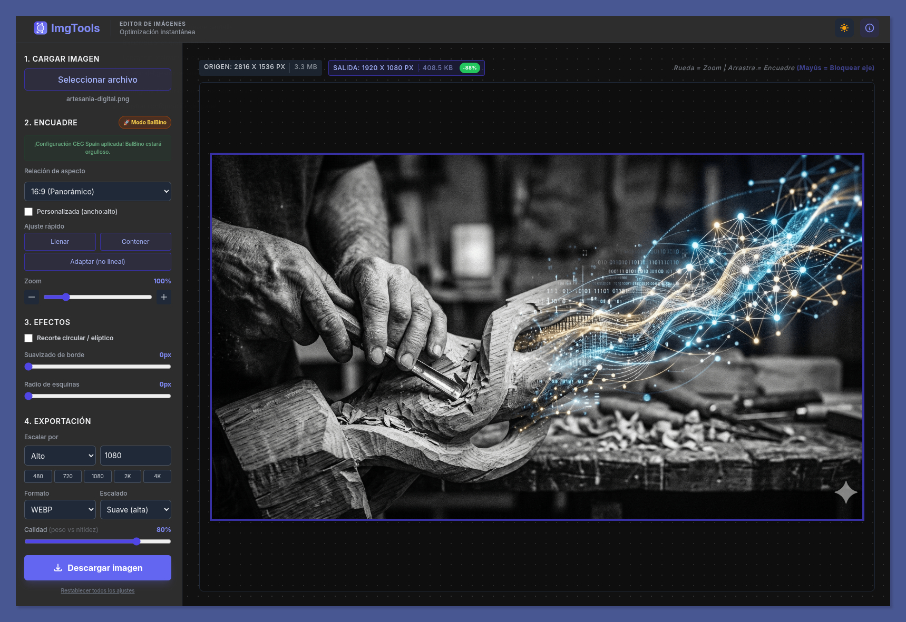
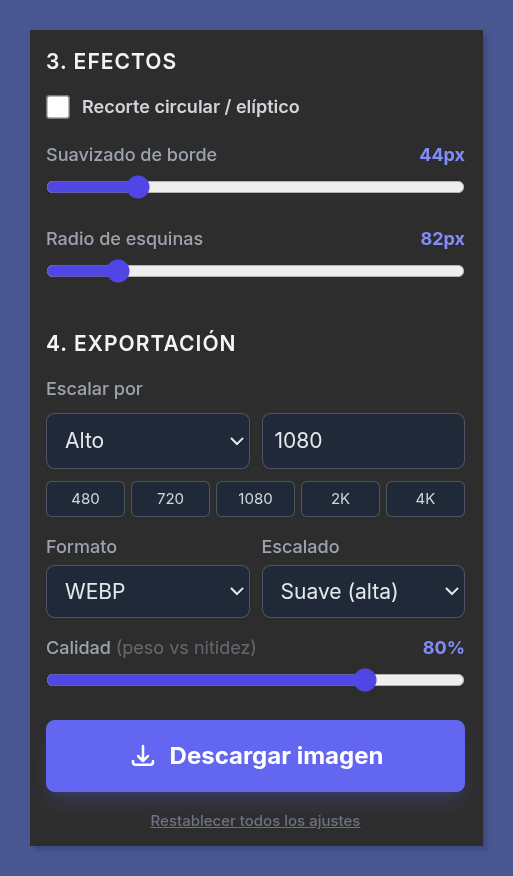
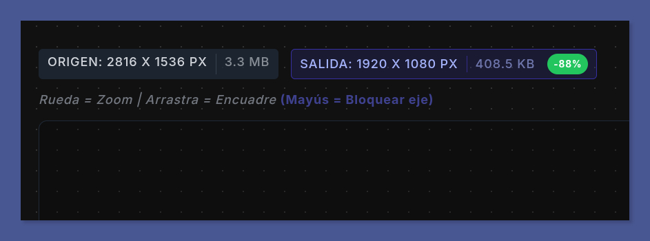

# ImgTools 📸 🚀

> La herramienta definitiva para conseguir que **BalBino** deje de dar la paliza 😘 con las cabeceras del blog de **GEG Spain**.

### 🌐 Acceso temporal a esta versión 2.0 (Beta): [pfelipm.github.io/imgtools](https://pfelipm.github.io/imgtools/)

> [!IMPORTANT]
> 🧪 **Release `v2.0` en fase beta:** Para probar esta nueva versión en desarrollo utiliza temporalmente **[https://pfelipm.github.io/imgtools/](https://pfelipm.github.io/imgtools/)**. El dominio de producción ([imgtools.pablofelip.online](https://imgtools.pablofelip.online)) mantiene por ahora la versión estable `1.0` hasta finalizar el periodo de pruebas.

  

## 🎯 ¿Por qué existe ImgTools?

Si eres parte del equipo de coordinación de **GEG Spain**, conoces el ritual. BalBino, con todo el amor del mundo y su infinita paciencia manteniendo nuestra web en [transformacioneducativa.es](https://transformacioneducativa.es), nos ha impuesto un flujo de trabajo digno de las doce pruebas de Hércules:

1.  Abrir una presentación de Google configurada a 1920x1080.
2.  Subir tu imagen, ajustarla a la diapo, rezar para que el encuadre sea 16:9.
3.  Descargar la diapo como imagen.
4.  Pasar por herramientas externas para que el archivo no pese más que nuestra conciencia.
5.  Subir a WordPress.

**¡Basta!** ImgTools nace como una "protesta-broma" cariñosa para automatizar este proceso. Queremos mucho a BalBino, pero queremos más nuestro tiempo. Con esta herramienta, lo que antes llevaba 5 minutos ahora se hace en 5 segundos.

## 🚀 El mítico "modo BalBino"

La joya de la corona. Un botón dorado que, al ser pulsado, configura mágicamente:
*   Relación de aspecto **16:9** perfecta.
*   Resolución de salida a **1080p** (el estándar de las cabeceras).
*   Formato **WebP** con optimización al **80%**.
*   Escalado de alta calidad.

**Resultado:** Una imagen lista para WordPress, ligera, nítida y, lo más importante, **BalBino-approved**.

## ✨ Características principales

### 1. Encuadre y adaptación inteligente

ImgTools ofrece un control total sobre cómo se sitúa la imagen en el lienzo final:

*   **Ratios preestablecidos:** `1:1`, `4:3`, `16:9`, `16:10`, `21:9`, `21:10` y dimensiones personalizadas (`ancho:alto`).
*   **Perfiles rápidos y preajustes propios:** selector compacto para *LinkedIn* (Post/Banner), *Instagram* (Cuadrado/Vertical), *YouTube* y cabeceras de *Google Classroom / Forms*, con guardado de perfiles propios en `localStorage` (respetando intacto el protagonismo de **🚀 Modo BalBino**).
*   **Orientación previa de origen:** gira en pasos de `90°` y voltea horizontal o verticalmente antes del encuadre y de la Adaptación No Lineal, pudiendo aplicarse solo a la imagen actual o a todo el lote con sincronización de miniaturas.
*   **Zoom y pan de precisión:** control suave centrado en el cursor, pellizco táctil (*pinch-to-zoom*), arrastre directo, doble clic para centrar y ajuste fino con flechas (`1 px`, o `10 px` con `Mayús`).
*   **Bloqueo de ejes:** mantén presionada la tecla **Mayús** mientras arrastras para desplazar la imagen solo en horizontal o vertical.
*   **Ajustes rápidos:**
    *   **Llenar:** escala la imagen hasta cubrir todo el lienzo (recorta el exceso).
    *   **Contener:** ajusta la imagen para que se vea completa, con selector de relleno de fondo (**Transparente**, **Desenfocado / *Blur-fill*** con brillo ajustable o **Color sólido**).
    *   **Estirar:** realiza un estiramiento lineal uniforme para ocupar todo el espacio.
    *   **Adaptar (no lineal):** la función estrella para redimensionar sin deformar el contenido esencial.

  

#### 🧠 Los secretos de la adaptación no lineal (ANL)

Esta función permite cambiar la relación de aspecto (por ejemplo, de una foto cuadrada a una panorámica 16:9) protegiendo al sujeto principal.

  
   
  <em>Demostración del algoritmo de adaptación no lineal en acción.</em>

**Funcionamiento interno:**
El motor de ImgTools divide la imagen en **60 rebanadas (slices)**. En lugar de aplicar un estiramiento uniforme, el algoritmo aplica una **curva de progresión** para distribuir la distorsión de manera desigual:
*   **Zona segura:** Define un área central (hasta el 80%) que mantiene su proporción original de 1:1. Es ideal para proteger rostros o logotipos.
*   **Desplazamiento (bias):** Permite descentrar la zona segura si el elemento importante de la foto no está en medio.
*   **Transición (power):** Controla la agresividad de la **curva de progresión**. Un valor alto hace que la distorsión sea casi imperceptible en la mayor parte de la imagen, concentrándola solo en los bordes extremos.

Para facilitar el ajuste, ImgTools muestra **guías visuales de alta visibilidad** (verde neón sobre fondo negro) mientras mueves los deslizadores, desapareciendo automáticamente al soltarlos.

### 2. Efectos y calidad

*   **Recorte circular o elíptico:** Máscaras geométricas perfectas para avatares o creatividades.
*   **Suavizado perimetral (feather):** Desenfoque de bordes que sigue la silueta de la imagen (rectangular o curva).
*   **Radio de esquinas:** Redondeo profesional ajustable con precisión de píxel.
*   **Límites inteligentes:** Todos los efectos escalan sus límites de forma proporcional a la resolución de salida, garantizando resultados consistentes en cualquier tamaño.

  

### 3. Carga rápida, exportación y rendimiento

*   **Formatos de entrada y salida:** importa **JPG**, **PNG**, **WEBP**, **SVG** vectorial (rasterizado limpio a alta densidad sin *tainted canvas*), **AVIF**, **GIF** y **BMP**; exporta en **PNG**, **WEBP**, **JPG** (con fondo blanco en transparencias) y **AVIF** cuando el navegador lo soporta.
*   **Flujo sin fricción y portapapeles:** carga archivos con *Drag & Drop* en cualquier punto de la ventana, pega capturas o SVG con **`Ctrl+V`**, mantén **Ver original** (o la tecla **`Espacio`**) para comparar al instante y copia la imagen resultante con **Copiar al portapapeles**.
*   **Procesamiento por lotes (Batch) y exportación `.zip`:** selecciona, arrastra o pega múltiples imágenes (`2+`) para trabajar con una receta global común, indicadores de ámbito en la barra lateral (`Lote` vs `● Actual`), conmutadores rápidos para orientación y ajuste rápido, tira de miniaturas con contador de ajustes propios, atajos **`Alt+←`/`→`** y exportación secuencial a un único archivo `.zip` sin recomprimir (*STORE* + CRC-32 en JavaScript puro).
*   **Motor de escalado:** control total sobre el método de suavizado (progresivo de alta calidad o píxel-art).
*   **Información en tiempo real:** compara el peso del archivo original con el de salida y visualiza al vuelo el ahorro o incremento porcentual.
*   **Ajuste fino numérico:** haz clic en cualquier etiqueta de valor (`Zoom`, `Calidad`, `Brillo del fondo`, `Suavizado`, `Radio`, `Zona segura`, `Desplazamiento`, `Transición`) para introducir el valor exacto por teclado.

  

## 🛠️ Instalación y uso

ImgTools es una **Progressive Web App (PWA) 100% privada y *offline***: todo el procesamiento ocurre en tu navegador y la aplicación no depende de servidores ni CDN externos para funcionar.

1.  **En línea / PWA instalable:** Accede en **[pfelipm.github.io/imgtools](https://pfelipm.github.io/imgtools/)** (canal beta `v2.0`) o en **[imgtools.pablofelip.online](https://imgtools.pablofelip.online)** (`v1.0` estable). En `v2.0` puedes instalarla como app de escritorio o móvil (**Instalar app**), usarla sin conexión mediante Service Worker y recibir imágenes compartidas desde el sistema (*Web Share Target*).
2.  **Local autónomo:** Descarga `index.html` y ábrelo directamente en cualquier navegador moderno; lleva su CSS compilado integrado, por lo que funciona incluso sin acceso a internet.

## 🤝 Contribuciones

Si quieres añadir más modos (¿un "modo Instagram"?, ¿un "modo LinkedIn"?), las pull requests son más que bienvenidas. Eso sí, el **modo BalBino** es sagrado y no se toca.

## ✍️ Autoría y agradecimientos

*   Creado con 💙 por [Pablo Felip Monferrer](https://www.linkedin.com/in/pfelipm/).
*   Inspirado por la incansable (y muy a menudo agotadora) labor de **BalBino** manteniendo la web de [GEG Spain](https://transformacioneducativa.es/).
*   Distribuido bajo la licencia **GNU AGPL v3**.
